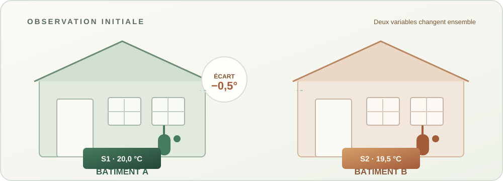
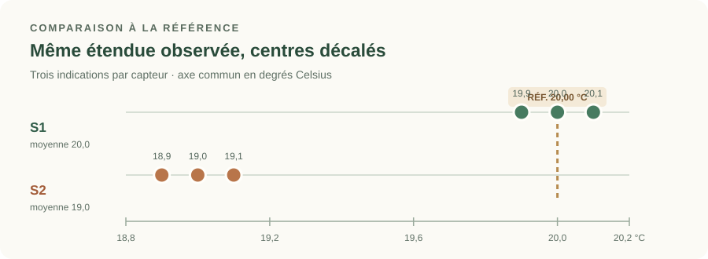
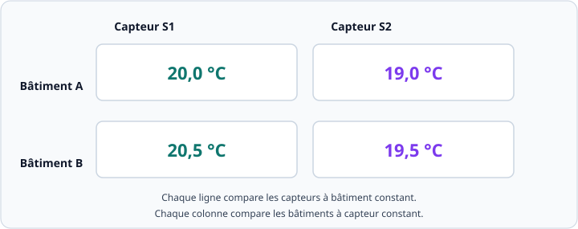

12–14 minStatistique · Métrologie · Design expérimentalSans prérequis

<strong>L'alerte est tombée à 9 h 12 : le bâtiment B est plus froid que le bâtiment A.</strong>

L'équipe s'apprête à modifier le chauffage. Mais les deux bâtiments n'utilisent pas le même capteur, et personne ne peut encore dire ce que le modèle a réellement mesuré : un bâtiment plus froid, ou un capteur qui indique moins. Les données permettent-elles de trancher ?

<nav class="story-route" aria-label="Les quatre étapes de l'enquête">
  <a href="#premier-signal">01<strong>Le signal</strong></a>
  <a href="#verification-capteurs">02<strong>La mesure</strong></a>
  <a href="#confusion-effets">03<strong>La confusion</strong></a>
  <a href="#plan-croise">04<strong>Le croisement</strong></a>
</nav>

## Le modèle a trouvé un écart. Mais entre quoi et quoi ? {#premier-signal}

Un modèle de suivi énergétique signale que le bâtiment B est plus froid que le bâtiment A. L'écart observé est de 0,5 °C. L'équipe envisage de modifier le chauffage. Le modèle ne reçoit pas directement la température réelle : il exploite les indications produites par les capteurs.

Un détail mérite pourtant attention : le bâtiment A est équipé du capteur S1, le bâtiment B du capteur S2. Chaque capteur est toujours associé au même bâtiment.

Le modèle compare donc deux choses à la fois :

- deux bâtiments, qui peuvent réellement avoir des températures différentes ;
- deux capteurs, qui peuvent ne pas indiquer la même valeur pour une même température.

**La question n'est pas encore de savoir quel bâtiment est le plus froid. Elle est de savoir si les données permettent de le déterminer.**

<figure class="story-hero">

LE SIGNAL DU MODÈLEAlerte à vérifier

−0,5 °CÉcart observé : B paraît plus froid

<figcaption>Le modèle compare deux bâtiments, mais aussi deux systèmes de mesure. À ce stade, impossible de savoir lequel explique l'écart.</figcaption>
</figure>

?
<strong>La décision est-elle justifiée ?</strong>
Avant de modifier le chauffage, il faut comprendre ce que les capteurs ont réellement mesuré.

Faites une première hypothèse : d'où peut venir l'écart de 0,5 °C ?

Deux explications sont compatibles avec ce premier constat :

<ul>
<li>le bâtiment B est réellement plus froid ;</li>
<li>le capteur S2 indique une température plus basse que S1, même lorsqu'ils observent la même température.</li>
</ul>

Les deux mécanismes peuvent aussi coexister. La suite de l'enquête doit produire une comparaison qui les distingue — pas simplement accumuler des relevés.

<aside class="editorial-note">Les nombres de cette enquête sont construits pour illustrer le raisonnement ; ils ne proviennent pas d'une campagne de mesure réelle.</aside>

## Première vérification : les capteurs disent-ils la même chose dans les mêmes conditions ? {#verification-capteurs}

L'équipe place les deux capteurs côte à côte dans un environnement stabilisé. Une référence étalonnée indique 20,00 °C ; son incertitude est documentée.

Système de mesure 01
<h4>Capteur S1</h4>
<strong class="sensor-reading">20,0 <small>°C</small></strong>

20,120,019,9

Moyenne des trois indications

Système de mesure 02
<h4>Capteur S2</h4>
<strong class="sensor-reading">19,0 <small>°C</small></strong>

19,119,018,9

Moyenne des trois indications

−1,0 °CÉcart entre les moyennes, dans cet essai

Trois relevés côte à côte autour d'une référence de 20,00 °C. Les valeurs individuelles restent visibles : l'écart moyen ne doit pas masquer la faible taille de l'essai.

<figure class="comparison-figure">

<figcaption>Les points montrent les six indications, pas une distribution théorique. Dans cet essai seulement, les deux capteurs ont la même étendue observée (0,2 °C) ; leurs moyennes sont séparées de 1,0 °C.</figcaption>
</figure>

Dans cette série, les deux capteurs présentent la même étendue observée, 0,2 °C. Pourtant, leurs moyennes diffèrent d'un degré. S2 indique environ un degré de moins que S1 dans ces conditions.

CE QUE L'ESSAI NOUS APPREND — ET CE QU'IL NE NOUS APPREND PAS

<strong class="insight-positive">Indice obtenu</strong>
À température de référence et dans les conditions de cet essai, les indications de S2 sont inférieures d'environ 1 °C à celles de S1.

<strong class="insight-caution">Question ouverte</strong>
Nous n'avons pas encore mesuré les deux capteurs dans les bâtiments réels. L'écart observé ne suffit donc pas à corriger la comparaison entre A et B.

Cette comparaison apporte un indice important, mais sa portée reste limitée :

- trois relevés ne suffisent pas à caractériser complètement la répétabilité d'un instrument ;
- un essai autour de 20 °C ne démontre pas que le décalage reste constant à d'autres températures ;
- l'incertitude de la référence n'est pas, à elle seule, l'incertitude complète de la comparaison.

On peut donc dire que les indications de S2 sont décalées dans cet essai. Au sens du [VIM (2.18)](https://jcgm.bipm.org/vim/fr/2.18.html), le biais de mesure est une estimation d'une erreur systématique. Ces trois relevés établissent un écart dans les conditions de l'essai, mais ne démontrent pas un décalage constant sur toute la plage d'utilisation.

La distinction utile pour la suite est simple : **la dispersion des indications répétées et leur proximité avec une référence sont deux propriétés différentes**. Un essai autour de 20 °C ne décrit pas toute la plage d'utilisation ; le vocabulaire qu'il mobilise est récapitulé ci-dessous.

Zoom métrologie : le vocabulaire du VIM appliqué à cet essai

<table>
<thead>
<tr><th>Notion</th><th>VIM</th><th>Ce que dit l'essai</th></tr>
</thead>
<tbody>
<tr><td>Fidélité</td><td><a href="https://jcgm.bipm.org/vim/fr/2.15.html">2.15</a></td><td>Les trois relevés de chaque capteur tiennent dans 0,2 °C : l'accord entre répétitions est bon, dans ces conditions.</td></tr>
<tr><td>Répétabilité</td><td><a href="https://jcgm.bipm.org/vim/fr/2.21.html">2.21</a></td><td>Cas particulier de la fidélité (mêmes conditions, courte durée) : trois relevés ne suffisent pas à la caractériser.</td></tr>
<tr><td>Justesse</td><td><a href="https://jcgm.bipm.org/vim/fr/2.14.html">2.14</a></td><td>S2 indique 19,0 °C pour une référence de 20,00 °C : la justesse de S2 est en cause dans cet essai.</td></tr>
<tr><td>Exactitude</td><td><a href="https://jcgm.bipm.org/vim/fr/2.13.html">2.13</a></td><td>Notion globale et qualitative : trois relevés ne permettent de déclarer aucun des deux capteurs « exact ».</td></tr>
<tr><td>Incertitude de mesure</td><td><a href="https://jcgm.bipm.org/vim/fr/2.26.html">2.26</a></td><td>L'incertitude de la référence ne couvre pas, à elle seule, l'incertitude de la comparaison S1–S2.</td></tr>
<tr><td>Étalonnage</td><td><a href="https://jcgm.bipm.org/vim/fr/2.39.html">2.39</a></td><td>Une comparaison ponctuelle à 20 °C n'est pas un étalonnage : aucune fonction de correction valable sur toute la plage.</td></tr>
<tr><td>Traçabilité métrologique</td><td><a href="https://jcgm.bipm.org/vim/fr/2.41.html">2.41</a></td><td>La référence doit être rattachée à une chaîne documentée d'étalonnages pour que l'écart soit interprétable.</td></tr>
</tbody>
</table>

Pour l'enquête, retenez simplement : une référence et son incertitude doivent être documentées, et l'essai doit couvrir le domaine d'utilisation.

## Pourquoi répéter davantage ne corrige pas le décalage

Un modèle minimal permet de séparer les deux contributions :

$$
X_i = \theta + b + \varepsilon_i
$$

- $\theta$ est la température recherchée ;
- $b$ est le décalage propre au système de mesure, supposé constant pendant la série ;
- $\varepsilon_i$ représente les fluctuations aléatoires.

Supposons que $\theta$ et $b$ restent constants et que les erreurs aléatoires soient indépendantes, centrées et de variance $\sigma^2$. La moyenne de $n$ mesures vérifie alors :

$$
\mathbb{E}[\overline X_n] = \theta+b,
\qquad
\operatorname{Var}(\overline X_n)=\frac{\sigma^2}{n}.
$$

Augmenter $n$ réduit la variabilité de la moyenne sous ces hypothèses. Mais son espérance reste $\theta+b$ : **la répétition ne retire pas le décalage systématique**.

<figure class="insight-figure">

CE QUE FAIT LA RÉPÉTITION<strong class="insight-good">La dispersion diminue</strong>
La moyenne devient plus stable si les erreurs sont indépendantes.

CE QU'ELLE NE FAIT PAS<strong class="insight-bad">Le biais reste</strong>
La moyenne reste centrée sur θ + b, pas sur θ.

<figcaption>Plus de mesures peuvent réduire l'incertitude aléatoire ; elles ne corrigent pas automatiquement une erreur systématique.</figcaption>
</figure>

Cette formule dépend de l'indépendance. Des mesures rapprochées dans le temps peuvent être autocorrélées ; dans ce cas, la variance de la moyenne n'est généralement plus $\sigma^2/n$. Cette limite rappelle qu'un grand nombre de lignes n'est pas nécessairement un grand nombre d'informations indépendantes.

Expérience de pensée : que changent 1 000 répétitions de chaque mesure initiale ?

Elles peuvent rendre les moyennes de A–S1 et B–S2 beaucoup plus stables. Mais elles ne produisent toujours aucune observation de A–S2 ni de B–S1.

Les moyennes deviennent plus stables ; la confusion entre bâtiment et capteur demeure. La prochaine étape doit modifier les associations observées, pas seulement leur nombre.

Mais le problème du réseau de capteurs est plus profond encore : même si chaque capteur fournissait des milliers de mesures très stables, pourrait-on séparer l'effet du bâtiment de celui du capteur ?

## Le vrai problème : deux effets parfaitement confondus {#confusion-effets}

Notons $Y_{s,c}$ la température indiquée dans le bâtiment $s$ par le capteur $c$. Un modèle additif simple serait :

$$
Y_{s,c} = \mu + \alpha_s + \beta_c + \varepsilon_{s,c},
$$

où :

- $\mu$ est un niveau de référence ;
- $\alpha_s$ représente l'effet associé au bâtiment ;
- $\beta_c$ représente le décalage associé au capteur ;
- $\varepsilon_{s,c}$ regroupe les variations non expliquées.

Or, dans le réseau initial, on n'observe que deux associations :

| Bâtiment | Capteur utilisé | Observation |
|---|---|---:|
| A | S1 | 20,0 °C |
| B | S2 | 19,5 °C |

<figure class="design-figure initial-design">

<figcaption>Schéma du plan de collecte, pas de mesures supplémentaires : les deux associations observées suivent toujours la même diagonale. Les deux autres combinaisons n'ont jamais été mesurées.</figcaption>
</figure>

La différence observée vaut −0,5 °C pour B par rapport à A. Mais, dans le modèle, elle correspond à :

$$
Y_{B,S2}-Y_{A,S1}
= (\alpha_B-\alpha_A)+(\beta_{S2}-\beta_{S1})+\text{résidu}.
$$

Une seule différence mélange donc deux effets inconnus : celui du bâtiment et celui du capteur. Les données ne disent pas quelle part revient à chacun.

Ce n'est pas un manque de puissance statistique. C'est un problème d'**identifiabilité** : le plan de collecte ne fournit pas les comparaisons nécessaires pour séparer les paramètres.

On peut le voir dans la matrice du modèle. En prenant A et S1 comme références, les colonnes représentent l'intercept, l'indicateur « bâtiment B » et l'indicateur « capteur S2 ». Le plan initial ne fournit que :

$$
X_{\text{initial}} =
\begin{bmatrix}
1 & 0 & 0 \\
1 & 1 & 1
\end{bmatrix}.
$$

Le rang de cette matrice vaut 2 : elle ne fournit que deux colonnes indépendantes pour trois paramètres. Le rang est le nombre de colonnes linéairement indépendantes de la matrice ; il indique combien de directions de variation le plan permet de distinguer. Ici, les deux dernières colonnes sont identiques : chaque fois que l'on observe le bâtiment B, on observe aussi S2. C'est une **colinéarité parfaite** créée par le plan de collecte ; le terme « confusion » désigne ici cette impossibilité structurelle de séparer les contributions, pas une conclusion causale sur le bâtiment. Leurs effets ne peuvent donc pas être estimés séparément. Répéter les mêmes associations ajoute des lignes de même structure ; cela n'augmente pas le rang de la matrice et ne résout pas la confusion.

On peut exprimer la même impossibilité sans calculer de rang. Si l'on augmente l'effet attribué au bâtiment B de $\delta$ et que l'on diminue d'autant l'effet attribué au capteur S2, les deux valeurs prédites restent inchangées :

$$
(\alpha_B+\delta)+(\beta_{S2}-\delta)
=\alpha_B+\beta_{S2}.
$$

Une infinité de couples d'effets explique donc exactement les mêmes observations. Ce n'est pas seulement une estimation instable : les paramètres ne sont pas séparément déterminés par ces données.

La question n'est donc pas de répéter davantage, mais de compléter les deux comparaisons absentes.

Avant de découvrir le nouveau plan : quelles mesures manquent ?

Il faut compléter les deux cases absentes : mesurer A avec S2 et B avec S1. Ces deux comparaisons permettent de changer de capteur sans changer de bâtiment, puis de changer de bâtiment sans changer de capteur.

## Le croisement change la question — et renverse la conclusion {#plan-croise}

Pour séparer les effets, il faut que chaque capteur mesure chaque bâtiment dans des conditions comparables. On obtient alors ce plan croisé :

| Bâtiment | Capteur S1 | Capteur S2 |
|---|---:|---:|
| A | 20,0 °C | 19,0 °C |
| B | 20,5 °C | 19,5 °C |

<figure class="design-figure crossed-design">

<figcaption>Les quatre cases sont maintenant observées. Les contrastes par ligne et par colonne apportent les comparaisons qui manquaient au plan initial ; leur interprétation comme effets principaux suppose l'additivité du modèle.</figcaption>
</figure>

Les comparaisons peuvent maintenant être faites à bâtiment constant ou à capteur constant :

- **À bâtiment constant** : S2 indique 1,0 °C de moins que S1, dans les deux bâtiments.
- **À capteur constant** : B est 0,5 °C plus chaud que A, avec chacun des capteurs.

LES QUATRE COMPARAISONS QUI DÉBLOQUENT L'ANALYSE
Chaque contraste maintient une dimension constante pendant que l'autre varie.

À bâtiment A constant<strong>−1,0 °C</strong><small>S2 − S1</small>

À bâtiment B constant<strong>−1,0 °C</strong><small>S2 − S1</small>

Avec le capteur S1<strong>+0,5 °C</strong><small>B − A</small>

Avec le capteur S2<strong>+0,5 °C</strong><small>B − A</small>

<strong>Les deux contrastes se reproduisent.</strong> C'est la signature attendue d'un modèle additif dans cet exemple construit ; ce n'est pas encore une preuve générale d'absence d'interaction.

Avec le même codage que précédemment, la matrice du plan croisé devient :

$$
X_{\text{croisé}} =
\begin{bmatrix}
1 & 0 & 0 \\
1 & 0 & 1 \\
1 & 1 & 0 \\
1 & 1 & 1
\end{bmatrix}.
$$

Son rang vaut 3 : les trois colonnes sont indépendantes. Le plan fournit ainsi trois contributions indépendantes pour distinguer les trois paramètres du modèle additif. Les deux effets principaux deviennent estimables. **L'identifiabilité ne garantit ni l'exactitude des mesures ni une faible incertitude sur les estimations** : le rang garantit ici que les paramètres sont séparables dans le modèle, pas que les mesures sont exemptes de biais résiduel ou de défaut de protocole.

Le renversement peut se lire directement dans les nombres. La différence initialement observée mélange les deux effets :

$$
\underbrace{19{,}5-20{,}0}_{-0{,}5\;\text{°C observé}}
=
\underbrace{(20{,}5-20{,}0)}_{+0{,}5\;\text{°C bâtiment}}
+
\underbrace{(19{,}5-20{,}5)}_{-1{,}0\;\text{°C capteur}}.
$$

Autrement dit, $-0{,}5 = +0{,}5 - 1{,}0$. Le bâtiment B est plus chaud de 0,5 °C dans cet exemple, mais son capteur indique 1 °C de moins. C'est cette contribution instrumentale qui inverse le signe de la comparaison naïve.

<section class="measurement-lab" data-measurement-lab aria-labelledby="measurement-lab-title">

EXPÉRIENCE INTERACTIVE · MODÈLE ADDITIF
  <h3 id="measurement-lab-title">Un même écart peut cacher plusieurs histoires</h3>

Faites varier séparément l'écart réel entre bâtiments et le décalage du capteur S2 par rapport à S1. Le signal initial est la somme des deux.

  <label class="measurement-control">
<strong>Effet du bâtiment</strong><output data-building-value>+0,5 °C</output>
    <small>Température de B − température de A</small>
    <input type="range" min="-2" max="2" step="0.1" value="0.5" data-building-effect aria-label="Effet du bâtiment, de moins 2 à plus 2 degrés">
  </label>
  <label class="measurement-control">
<strong>Décalage du capteur</strong><output data-sensor-value>−1,0 °C</output>
    <small>Indication de S2 − indication de S1 à température égale</small>
    <input type="range" min="-2" max="2" step="0.1" value="-1" data-sensor-effect aria-label="Décalage du capteur, de moins 2 à plus 2 degrés">
  </label>

Effet bâtiment<strong data-building-value>+0,5 °C</strong>

+

Effet capteur<strong data-sensor-value>−1,0 °C</strong>

=

Écart observé<strong data-observed-value>−0,5 °C</strong>

Même signal observé que dans l'enquête.

Comparer deux explications du même signal :
  <button type="button" data-preset="0.5,-1">Scénario de l'enquête</button>
  <button type="button" data-preset="-0.5,0">Autre explication</button>

Cette expérience illustre l'identifiabilité dans un modèle additif simplifié. Elle ne remplace pas le plan croisé : celui-ci apporte les observations nécessaires pour estimer séparément les deux effets.

</section>

<figure class="reversal-figure">
LE RENVERSEMENT

Lecture initiale<strong>−0,5 °C</strong>
B semble plus froid

→

Après séparation des effets<strong>+0,5 °C</strong>
B est plus chaud dans l'exemple

<figcaption>La conclusion change de signe quand on distingue l'effet du bâtiment du décalage du capteur. Ce n'est pas le modèle qui a changé : c'est l'information disponible.</figcaption>
</figure>

**Le décalage du capteur a inversé le signe de la conclusion.**

Le croisement rend les effets principaux identifiables sous une hypothèse : le décalage de chaque capteur doit être le même dans les deux bâtiments. C'est le modèle additif, sans interaction capteur × bâtiment.

Une manière de rendre cette hypothèse visible consiste à comparer les écarts entre capteurs dans chaque bâtiment. Ici :

$$
\begin{aligned}
\Delta_{A} &= 19{,}0-20{,}0=-1{,}0\;^\circ\mathrm C,\\
\Delta_{B} &= 19{,}5-20{,}5=-1{,}0\;^\circ\mathrm C.
\end{aligned}
$$

L'écart entre ces deux écarts — une différence de différences — vaut zéro dans le tableau construit. C'est ce que prédit le modèle sans interaction. Si les deux écarts différaient, cela pourrait signaler une interaction capteur × bâtiment, mais aussi du bruit de mesure ou une variation des conditions entre les relevés.

Cette hypothèse doit donc être examinée, et non simplement postulée. Le montage, l'humidité, le rayonnement ou les conditions locales peuvent modifier différemment la réponse d'un capteur selon le site. **Avec une seule valeur par combinaison, on ne peut pas distinguer une interaction réelle de la variabilité aléatoire** : il faut des répétitions par combinaison pour estimer cette variabilité et évaluer les écarts au modèle additif. Le tableau illustre l'identification des effets principaux sous hypothèse ; il ne constitue pas une validation complète du modèle.

LE POINT DE VIGILANCE
<strong>Un plan croisé rend les effets principaux séparables ; il ne garantit pas que le modèle additif est vrai.</strong>

Si l'écart entre capteurs dépend du bâtiment, il existe une interaction capteur × bâtiment. Une seule observation par case ne permet pas de distinguer cette interaction du bruit. Il faut répéter les quatre combinaisons et contrôler les conditions expérimentales. Le contraste associé au bâtiment n'est pas automatiquement un effet causal : d'autres différences propres aux sites peuvent encore intervenir.

En pratique, un plan croisé n'est informatif que si les conditions de comparaison sont maîtrisées. Il faut notamment :

<ol class="field-protocol">
<li><strong>Créer le recouvrement.</strong>Mesurer les deux capteurs dans chaque bâtiment, sur des périodes aussi comparables que possible.</li>
<li><strong>Neutraliser le temps.</strong>Synchroniser les relevés ou utiliser une référence commune ; randomiser ou alterner l'ordre des capteurs.</li>
<li><strong>Stabiliser les conditions.</strong>Contrôler emplacement, orientation, temps de stabilisation et exposition au rayonnement.</li>
<li><strong>Quantifier la variabilité.</strong>Répéter les quatre combinaisons afin d'estimer la variabilité et de rechercher une interaction.</li>
</ol>

Si les capteurs ne peuvent pas être déplacés, un dispositif de transfert ou une référence commune peut créer le recouvrement nécessaire. Un croisement mal contrôlé ne résout pas le problème ; il le déplace.

## Ce que cela change dans le travail d'un data scientist

Dans cet exemple, chaque bâtiment est associé à un capteur différent. Le modèle peut alors utiliser le décalage propre au capteur comme indice indirect du bâtiment. Mais les données ne permettent pas de savoir si la prédiction repose sur une différence entre bâtiments ou sur le système de mesure.

Une bonne performance prédictive dans ce plan ne suffit donc pas à valider l'interprétation de la variable ni sa capacité à rester valable dans un autre contexte — sa **transportabilité** — notamment si les associations site–capteur changent.

Trois stratégies ne sont pas équivalentes :

1. **Ajouter des lignes sans changer le plan** réduit éventuellement la variabilité des moyennes, mais ne sépare pas les effets confondus.
2. **Complexifier le modèle** ne crée pas les comparaisons absentes des données. Un algorithme plus flexible peut apprendre l'association observée sans pouvoir en identifier séparément les composantes.
3. **Modifier le plan de collecte** — mesure croisée, référence commune, recouvrement entre groupes — apporte l'information qui manque, sous des conditions expérimentales explicites.

Avant d'interpréter l'effet d'un site, demandez-vous donc :

LA QUESTION À EMPORTER DANS VOS PROPRES DONNÉES<strong>Existe-t-il des observations qui permettent de comparer les groupes sans changer simultanément de système de mesure ?</strong>
Si la réponse est non, la limite se situe dans le plan d'observation : cherchez du recouvrement, une référence commune ou une expérience complémentaire. Un découpage train/test ou une nouvelle architecture ne réparera pas une non-identifiabilité déjà présente dans les données.

## La leçon de l'enquête

Le modèle n'avait pas « mal calculé ». Il avait répondu à une question que le plan de mesure ne permettait pas de trancher. La faiblesse se trouvait en amont de l'algorithme.

Et le chauffage ? L'équipe a suspendu la modification. Dans le plan initial, la décision reposait sur une comparaison que les données ne permettaient pas de trancher. Après le croisement, la question se pose autrement : le bâtiment B est probablement plus chaud, pas plus froid.

À EMPORTER

La quantité de données ne remplace pas l'information apportée par un bon plan de mesure.

<ul>
<li>Une faible dispersion ne garantit pas la proximité avec la valeur recherchée.</li>
<li>Répéter les mêmes associations ne sépare pas des effets confondus.</li>
<li>Un plan croisé apporte les comparaisons manquantes, sous les hypothèses du modèle.</li>
<li>L'identifiabilité est une propriété du couple <em>modèle + plan de collecte</em>, pas une qualité que l'on ajoute après coup avec un algorithme plus complexe.</li>
</ul>

## Références et approfondissements

- **[Vocabulaire international de métrologie — JCGM 200:2012](https://doi.org/10.59161/JCGM200-2012)** — définitions normatives ; consulter directement [2.13 — Exactitude](https://jcgm.bipm.org/vim/fr/2.13.html), [2.14 — Justesse](https://jcgm.bipm.org/vim/fr/2.14.html), [2.15 — Fidélité](https://jcgm.bipm.org/vim/fr/2.15.html), [2.18 — Biais de mesure](https://jcgm.bipm.org/vim/fr/2.18.html), [2.21 — Répétabilité](https://jcgm.bipm.org/vim/fr/2.21.html), [2.26 — Incertitude](https://jcgm.bipm.org/vim/fr/2.26.html), [2.39 — Étalonnage](https://jcgm.bipm.org/vim/fr/2.39.html) et [2.41 — Traçabilité métrologique](https://jcgm.bipm.org/vim/fr/2.41.html).
- **[Guide pour l'expression de l'incertitude de mesure — JCGM 100:2008](https://doi.org/10.59161/JCGM100-2008F)** — pour approfondir l'évaluation et la combinaison des composantes d'incertitude. Le BIPM signale aussi l'[amendement 1:2026 sur la non-linéarité des modèles de mesure](https://doi.org/10.59161/PPDI3267), qui dépasse le cas additif illustré ici.
- **[NIST Technical Note 1297](https://www.nist.gov/pml/nist-technical-note-1297)** — introduction opérationnelle à l'évaluation et à l'expression de l'incertitude.

Les questions de réflexion et les exercices corrigés sont regroupés dans un [atelier séparé](../exercices/jour-01.html).

## Connexions

- [Jour 2 — 50 000 réponses valent-elles mieux que 1 000 ?](jour-02.html) : une mesure peut être correcte, mais la population observée peut rester biaisée.
- [Jour 4 — Quand la covariance change-t-elle la variance d'une somme ?](jour-04.html) : les dépendances entre observations modifient l'information apportée par les répétitions.

